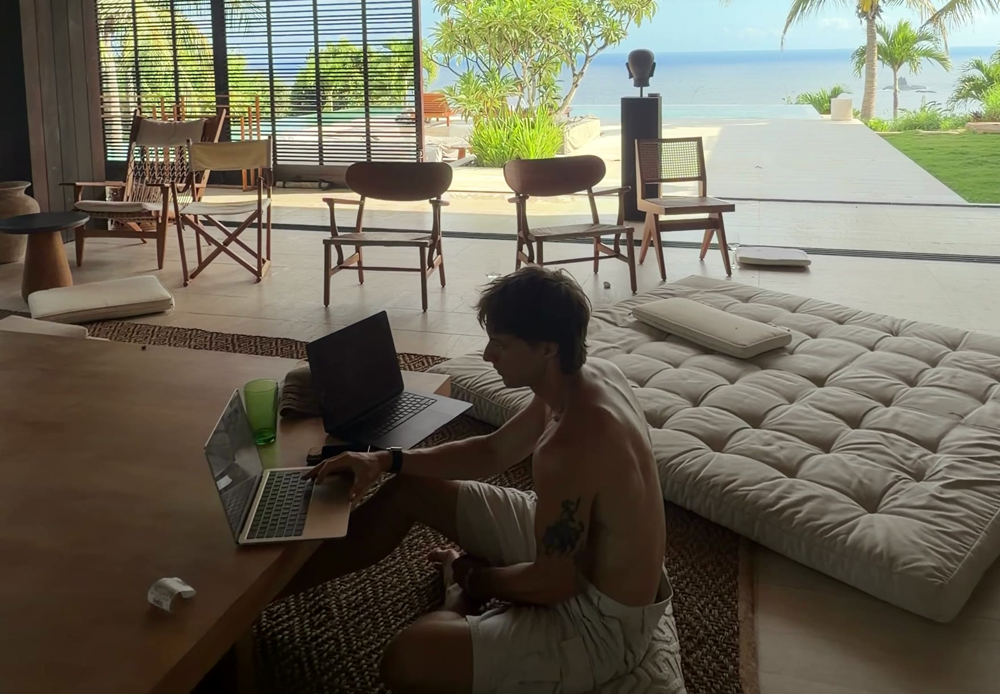

<h1 align="center">Reels kit</h1>

<p align="center">
  <em>Film it and say what you want. Claude turns it into a finished<br>
  Instagram reel, in your words, on your Mac.</em>
</p>

<p align="center">
  
  
  
  
</p>

<p align="center">
  <a href="#install">Install</a> &middot;
  <a href="#updates">Updates</a> &middot;
  <a href="#already-make-reels-with-claude">Already make reels?</a> &middot;
  <a href="#every-day">Every day</a> &middot;
  <a href="#good-to-know">Good to know</a>
</p>

<p align="center">
  
</p>

An Instagram manager and reel editor that runs in the Claude app. You
film and say what you want. Claude plans, writes and edits, and you post.

- **Ideas that work.** It finds what is working on pages like yours and
  brings you reel ideas with hooks.
- **Scripts in your words.** Tell Claude what you want to say in a voice
  note or rough notes, and it writes the script the way you talk.
- **Finished reels.** It turns your talking-to-camera footage, b-roll and
  photos into finished reels. On macOS 26 or newer it edits in Palmier
  Pro, a free video editor app where you watch every change live and
  nothing is rendered until the reel is ready.
- **It learns.** Tell it once what you don't like, and it remembers.

**You need** a Mac with an Apple chip (M1 or newer) on macOS 15 or newer,
the Claude app and a paid Claude plan (Pro or higher). On an older macOS
the install stops and asks you to update macOS first, because the tools
would otherwise be built from scratch for hours.

<sub>Built on the
[Instagram skills](https://github.com/Jakeschincariol/instagram-agent-skill),
[HyperFrames](https://github.com/heygen-com/hyperframes),
[Palmier Pro](https://github.com/palmier-io/palmier-pro) and a script
method adapted from [Ekos Labs](https://github.com/Ekos-Labs/skills),
which is included in the kit as text.</sub>

## Install

Before you start, update your Mac and Claude. In System Settings,
General, Software Update, install the newest macOS it offers and
restart. A new version of macOS is often listed on its own, under the
updates, with an Upgrade Now button: install that one too. Then open the
Claude app and choose Claude, Check for Updates.

1. Make a new, empty folder called `Reels` in your home folder (in
   Finder: Go, Home, then File, New Folder). It must stay where it is
   after step 4. Not in iCloud Drive, Dropbox or Google Drive, and not
   on an external disk: the tools are about 35,000 files that must not
   sync.
2. Open the Claude app and click **Code**.
3. Under the message box, click the folder button and choose the `Reels`
   folder. If Claude asks whether you trust this folder, say yes. If your Mac
   asks whether Claude may access that folder, click Allow.
4. Paste this and press Return:

   ```
   Download
   https://github.com/frederikhejlskov/reels-kit/raw/main/setup.sh
   into this folder, run "bash setup.sh --update", then read CLAUDE.md
   and do what its Install section says.
   ```

   Claude fetches the kit and first checks your Mac: free space, macOS,
   the network and the tools already on it. If something is not ready,
   you get one list of what to fix before anything is installed. Then
   Claude installs the free tools and tells you what to click. Windows
   may ask you to install command line developer tools (click Install,
   then Agree) or for your Mac password (type it, click OK). It can take
   up to 40 minutes. Allow about 6 GB free during install and about 2 GB
   afterwards, plus room for your footage.
5. When Claude says "All set", quit the Claude app (Command Q) and open it
   again. Start a new Code session in the `Reels` folder and type
   `set me up`. The kit includes video tools for editing your footage.
   The first time Palmier Pro opens it shows a sign-in screen: click
   Skip. An account is only needed for Palmier's paid AI extras, which
   the kit never uses unless you ask.
   Claude asks whether you already have a reels folder or brand notes,
   then about your page (handle, what you do, your goal, pages you look
   up to), reads your public profile, works out which of
   your reels worked and why, scores your profile with the fix worth the
   most, learns your voice and look, then asks what you want first: reel
   ideas, a reel from your footage, or reels cut from a long video, podcast
   or article you have.

If Claude says it may not read or change files in the `Reels` folder,
your Claude settings limit which folders it can use. Move the `Reels`
folder into a folder where Claude already works for you, open it there
and paste the message again.

Got the kit as a zip file instead? Double-click it, choose the `Reels`
folder that appears in step 3, and type `install` in step 4.

## Updates

The kit keeps itself up to date. Each time you start a session, and
before each new reel, it looks for a newer version and takes it, which
replaces only the kit's own files, never yours, and Claude tells you in
one line what changed. To stop that, tell Claude "no automatic updates".

If Claude has never told you the kit updated itself, paste the message
from step 4 of "Install" once in your `Reels` folder. After that it
updates itself.

## Already make reels with Claude?

Keep your current folder exactly as it is, and don't copy these files into
it: the kit lives in its own `Reels` folder. During `set me up`, Claude
first asks whether you already make reels with Claude or have brand notes,
and where: a folder on your Mac, a Claude chat project, or both.

- A chat project: Claude gives you a short message to paste there, and you
  paste the reply back.
- A folder: type its name, or drop it on the message box (that only
  tells Claude where it is; the folder stays put). Click Allow when
  Claude asks to read it.
  Claude reads your notes, scripts and finished reels, plus what you told
  Claude in past chats in that folder and what it saved about you, so the
  corrections you already gave carry over.
- Brand notes as files: drop them into `setup/brand`.

Then Claude asks only what is still open. You can answer, or paste a short
message into a Claude chat in your usual folder and let the Claude that
knows you answer (click Allow when it asks to write into `Reels`). Claude
changes nothing in your usual folder without asking you first, and if you
keep working there too, it picks up what is new.

You can keep the way you edit now and use the kit for the rest: ideas from
what is working on pages like yours, hooks, scripts in your voice and post
captions. Claude asks once which editor makes your reels, yours or the
kit's, and uses only that one on a reel, because two editors on the same
reel undo each other's work. You can switch any time.

Leave your old folder where it is instead of moving it into the `Reels`
folder. If it does end up inside, Claude finds it, reads it as notes and
keeps using the editor you chose.

## Every day

Open the Claude app, click **Code**, start a new session in the `Reels`
folder. Claude tells you what is next in your plan. Or say what you want,
for example "make a reel from today's footage" or "give me ideas for next
week". Claude shows you the edit plan first and waits for your yes. You post
the reel yourself.

Talking reels or cinematic ones, where the footage and music carry it:
Claude asks which you make, and any reel can be the other kind. Reels you
love: paste links to three to five of them in the chat, or a link to an
account whose reels you love. Claude matches your cinematic reels to
their pace, framing and look.

Brand guidelines, brand fonts or a logo: drop them into `setup/brand` any
time. Claude uses their colours, fonts and tone for your reels, adds your
logo when you ask, and asks before installing a font.

When you don't like something, say so. Claude fixes it and, if it should
apply to every reel, saves it so you never have to repeat it. Your details
live in files in the `Reels` folder (`profile.md`, `voice.md`, `design.md`,
`ideas.md`), which kit updates never touch. One `Reels` folder is one
Instagram page: for a second page or a test, install the kit again in a
new folder.

## Good to know

- Out of the box the kit uses free tools only, only reads public Instagram
  pages and never posts, likes, follows or messages. You can change any of
  that by asking, for example to pull footage from Dropbox or add a paid AI
  video tool. Claude tells you the cost first.
- If you prefer Terminal: run `bash setup.sh` inside the `Reels` folder, then
  start `claude` there. `bash setup.sh --check` checks everything anytime.
